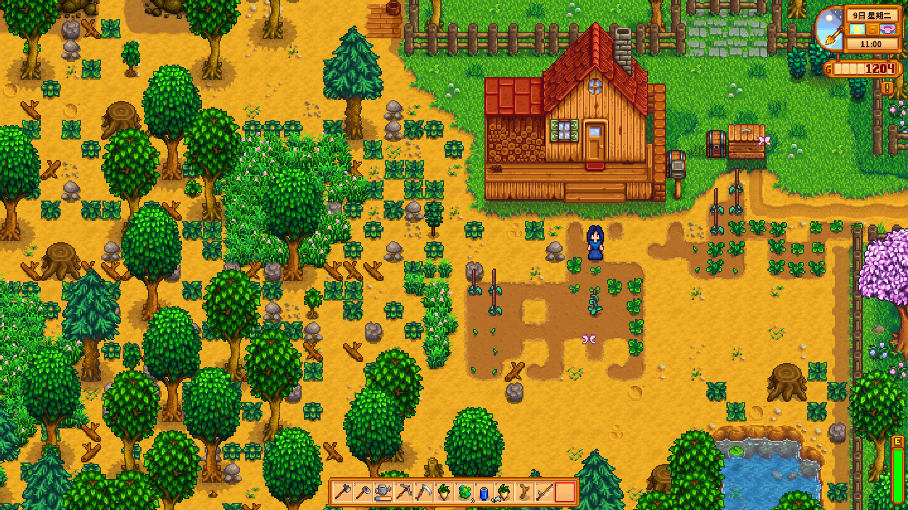
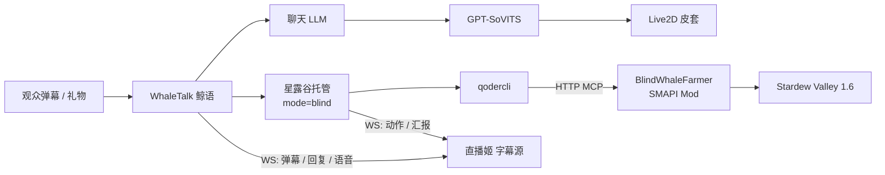

# 让大肥鱼自己玩《星露谷物语》

> 大肥鱼直播实验的工程笔记：文本 MCP 盲操作 + 弹幕聊天 + 语音解说 + 直播字幕

一句话：**不读屏幕、不控鼠标**，让 LLM 通过 SMAPI Mod 暴露的文本工具自己种地、钓鱼、下矿；主播照常和弹幕聊天，游戏动作以低优先级语音和字幕播出来。

这不是一个开箱即用的发行版，而是一份**可复现的实战记录**：哪些设计有效、哪些地方会翻车、直播时真正影响观感的是什么。上游项目都在快速迭代，接口和配置可能变化。

---

## 观众看到的样子



- 游戏窗口是干净的 1920×1080，没有 HUD、没有调试面板。
- 左下角是字幕层，最多 4 条卡片：
  - `弹幕`（粉色）：观众说了什么；
  - `动作`（青色）：这一轮实际做了什么；
  - `肥鱼`（蓝色）：AI 主播说出口的话。
- 一条弹幕和它的回复会**成组显示 30 秒**，观众能看出在回谁。
- 部分游戏动作会有一句语音解说；每轮结束的汇报也会读出来，但**永远排在弹幕回复后面**，不抢观众的话。

## 系统结构



两条 LLM 回路，互不阻塞：

1. **聊天回路**：弹幕 → 回复 → TTS。回复可以带一句“游戏现场”，但现场信息有独立的过期时间。
2. **游戏回路**：定时取游戏状态 → qodercli 用 MCP 工具操作 → 结果回写字幕和语音。

两条回路只通过一份**有时效的游戏现场摘要**相连，不共享长上下文。

## 三条设计原则

1. **默认关闭，附加式接入。** 不开启星露谷托管时，原来的聊天、点歌、Live2D 直播路径完全不变。
2. **不抢弹幕的话。** 游戏解说是低优先级的语音，排在弹幕、礼物、醒目留言之后；动作解说每轮最多两句，还有全局间隔和浇水间隔；每轮结束的汇报再单独排一句。
3. **字幕只显示结果，不显示内部过程。** 隐藏走路、等待、开菜单、整理背包、坐标等工具细节，只保留“浇水 / 收获 / 下矿 / 睡觉”这类观众能理解的结果。

## 一轮托管发生了什么

```text
每 45 秒（可配）：
  1. MCP get_state              # 时间、金钱、体力、地点、当前界面、文字地图
  2. 提取 200 字以内的现场摘要   # 给下一轮 prompt，也给聊天回路用
  3. qodercli -p --max-turns 36  # 只允许 mcp__stardew__* 工具
  4. 每个 tool_use：
       - 推一条“动作”字幕
       - 有对应台词就排一句低优先级语音
  5. 结束：
       - update_notes 写下未来 1–2 天计划
       - 用鱼的口吻对观众说一句 ≤40 字的话
       - 这句话同时作为“动作”字幕和语音播出
  6. 睡下时写入“刚睡醒”占位，避免跨天旧状态污染聊天
```

关键点不是“让模型玩一整天”，而是**每轮只推进一小步**：最多 3 个写操作，失败一次就换目标。长计划放在 Mod 的笔记里，不放在一次 prompt 里。

## 最短复现路径

前置：Windows 10/11、Stardew Valley 1.6、SMAPI 4.x、[BlindWhaleFarmer](https://github.com/Darianliu23/dsh-stardew-blind-whale-farmer) 1.0.3、Qoder CLI（已登录）、一个能播 TTS 的直播管线（本实验用的是 [WhaleTalk](https://github.com/helplesspur/WhaleTalk-) 的本地改动）、OBS 或哔哩哔哩直播姬。

1. **装 Mod**：把 BlindWhaleFarmer 放进 `Mods/`，确认只有这一个“会替玩家操作”的 Mod 启用。
2. **改 Mod 配置**：`ShowHud: false`、`EnableMcp: true`、`McpPort: 18080`、`McpFreezeTime: true`、`McpIdleSeconds: 120`，重启游戏。`ShowHud` 只在启动时读取。
3. **验 MCP**：`python examples/blind_mcp_client.py 18080 get_state`，能打印出地点、时间、金钱、体力即可。
4. **验一轮**：用示例里的 prompt 手动跑一次 qodercli，确认它先 `get_state`、再做 1–3 个写操作。
5. **接直播层**：参考 [examples/config.example.json](examples/config.example.json) 设置 `mode=blind`、`blind_interval=45`、`mention_probability=100`、`narrate=true`。
6. **接字幕**：把 `overlay` 页面作为浏览器源，先加 `?demo=1` 看效果；正式源不要带 demo。
7. **开播顺序**：进存档 → TTS 引擎 → 直播软件 → 连接弹幕 → 再启动托管。

> 不要在游戏里开着对话框 / 剧情时停止托管或断开 MCP，原因见 [docs/field-notes.md](docs/field-notes.md#3-对话框崩溃不是玄学)。

完整的配置项、prompt 和运维细节在 `docs/` 里。

## 最值得分享的 8 个坑

1. **游戏状态会过期。** 一轮托管跨过“睡觉”后，聊天还在用昨天的雨天和体力，AI 会一本正经地说错。修复：现场摘要 180 秒过期、睡下写“刚睡醒”占位、prompt 要求数字照抄。
2. **对话框会冻结游戏时间。** 回合看起来卡死，其实在等 NPC 说话。用 `dialogue` 工具推进/关闭；API 里的 `line` 是回合开始时的缓存，别拿它判断实时场景。
3. **在对话中停托管会崩游戏。** `DialogueBox.closeDialogue()` 的空引用会让 UI 栈坏掉，只能重启游戏。先关对话，再停托管。
4. **动作语音不能直接 `say()`。** 那会打断正在回复的弹幕。用低优先级队列，最多两句/轮，10 秒全局间隔，浇水 150 秒一次。
5. **静态台词容易“说错事实”。** 比如台词里写了铜矿、镐子、鸡，但这一局根本没有。要么写不带事实的反应句，要么让模型结合现场生成一句。
6. **字幕显示内部工具会毁掉观感。** `wait`、`move_to (65,22)`、`close_menu` 这些不该出现；只显示结果，坐标和过程全部隐藏。
7. **弹幕和回复分开显示，观众不知道在回谁。** 把“这条弹幕 + 它的回复”合成一组，30 秒后一起消失；只按类型和文本匹配，不能只看时间。
8. **直播窗口和 DPI 会坑截图。** 150% 缩放下 DPI-unaware 截图是 2560×1440，和窗口坐标对不上。用 Win32 `GetClientRect` 或固定 1920×1080 的 helper，重启游戏后重跑。

展开的排查过程、代码片段和规则在 [docs/field-notes.md](docs/field-notes.md)。

## 成本

- 游戏回路消耗 **Qoder credits**（或你换成的任意 LLM）；聊天回路也在消耗。这一套都是让 Qoder 帮忙接入的，大肥鱼消耗的 token 也是用的 Qoder 的，现在这个智能体工作台也免费送额度 https://qoder.com/activities?referral_code=cKBVVUyn4XbiBQrxjy4t6d4T9el5tkHt，token 挺耐烧的，体验挺好的。
- TTS 是本机 GPT-SoVITS，不按 token 计费，但占 GPU。
- 这套配置用 `Fast` 模型、45 秒间隔、单轮最多 36 turns / 600 秒；一轮通常只有几次工具调用。
- **不要照抄网上的“每小时多少钱”**：模型、缓存命中、prompt 长度、每轮动作数都会变。用你自己的账号跑一小时，数日志里的 `大肥鱼托管：` 条数，再看用量面板，才有意义。

可调杠杆和测量方法见 [docs/cost.md](docs/cost.md)。

## 适用边界

**适合：**

- 单人、存档自己的游戏；
- 游戏状态能通过 Mod / API 转成文本；
- 以“陪伴型直播”为主，不追求高强度操作；
- 能接受模型偶尔犯蠢，并且有人看着。

**不适合：**

- 动作游戏、需要视觉判断的 UI；
- 竞技、多人联机里影响他人体验；
- 完全无人值守的长时间运行（目前没有对话 watchdog）；
- 需要 100% 准确的攻略型直播。

## 仓库内容

```text
README.md                  # 你正在看的这份
CHANGELOG.md               # 相对上游做了什么（字幕、盲托管、语音、修复）
docs/field-notes.md        # 踩坑记录：状态过期、对话崩溃、语音优先级、字幕配对
docs/prompts.md            # 实际使用的 prompt 与调参理由
docs/streaming.md          # 字幕/WS 契约、直播姬设置、窗口与隐私
docs/cost.md               # 成本构成与测量方法
examples/config.example.json
examples/blind_mcp_client.py   # 最小可用的 MCP 客户端（JSON / SSE 都兼容）
```

## 隐私与合规

- **不要提交** `config.json`、Cookie、API Key、Qoder 凭据、`logs/`、存档、带观众昵称的截图。
- 截图只截游戏窗口，不要截整个桌面；聊天区、后台、Key 都可能入镜。
- 如果平台要求标注 AI 生成内容，按平台规则标注。
- 只在自己拥有的存档/服务器里玩；不要用这套东西去多人服里挂机或干扰别人。
- 本仓库不包含游戏素材、Mod DLL、皮套模型或任何第三方二进制。

## 上游与致谢

- [WhaleTalk 鲸语](https://github.com/helplesspur/WhaleTalk-) — 弹幕、LLM 回复、TTS、Live2D、OBS/直播姬字幕（MIT）
- [BlindWhaleFarmer](https://github.com/Darianliu23/dsh-stardew-blind-whale-farmer) — 把星露谷状态转成文本、通过 MCP 执行高层动作（MIT）
- [SMAPI](https://smapi.io/) — Stardew Modding API
- [GPT-SoVITS](https://github.com/RVC-Boss/GPT-SoVITS) — 本地语音合成
- [star](https://github.com/CSXizhang/star) — 另一条“AI 陪伴 + 游戏状态”路线，本实验早期用过，后因“同时只能有一个替玩家操作的 Mod”而停用
- [Stardew Valley](https://www.stardewvalley.net/) — ConcernedApe；本仓库不附带任何游戏资源

“大肥鱼”是这次实验里 AI 主播的昵称；直播间的具体配置、皮套和音色不在本仓库内。

## License

本仓库的原创文字和代码示例使用 MIT License，见 [LICENSE](LICENSE)。上游项目、游戏、Mod、皮套和商标归各自作者所有。
